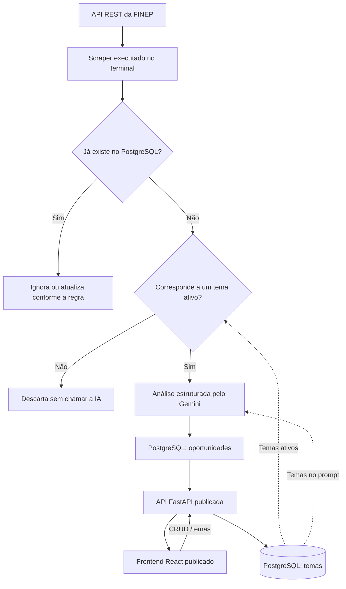

# Fluxo de Dados e Processamento

Este documento descreve o caminho dos dados desde a FINEP até a interface publicada.

## 1. Coleta

O `backend/scraper_ai.py` é executado manualmente no terminal. Ele:

1. consulta o endpoint REST público de chamadas da FINEP;
2. desserializa a resposta JSON;
3. ignora itens antigos ou encerrados;
4. infere o link público da chamada e verifica duplicidade no PostgreSQL;
5. carrega os temas ativos da tabela `temas`.

## 2. Filtro de temas

O scraper normaliza o texto dos campos retornados pela FINEP e procura correspondências com os temas cadastrados.

- Sem correspondência, o item é descartado sem chamada ao Gemini.
- Com correspondência, o item segue para análise semântica.

Essa etapa reduz custo, tempo de processamento e volume enviado à IA.

## 3. Análise com Gemini

Para itens aprovados no filtro, o scraper envia ao Gemini um bloco contendo:

- título;
- descrição bruta;
- taxonomia;
- datas de vigência;
- prazo proposto;
- link público;
- temas ativos.

A resposta é validada pelo schema `Oportunidade` e contém categoria, resumo, tema, prazo, aderência e demais campos necessários à interface. O texto bruto original também é preservado.

## 4. Persistência

O resultado validado é inserido ou atualizado no PostgreSQL:

1. o link e o título são verificados para evitar duplicação;
2. oportunidades existentes podem ser atualizadas com o conteúdo mais recente;
3. oportunidades novas são inseridas com `link` único;
4. os temas permanecem disponíveis para o próximo ciclo de coleta.

## 5. Distribuição pela API

O frontend nunca consulta o PostgreSQL diretamente. Ele envia requisições HTTPS para a API FastAPI publicada:

- `GET /oportunidades` retorna oportunidades ordenadas por data;
- `GET /temas` retorna os temas cadastrados;
- as rotas `POST`, `PUT` e `DELETE /temas` permitem o gerenciamento dos temas;
- `GET /health` permite verificar a disponibilidade da API.

A API usa a variável de ambiente de conexão para acessar o PostgreSQL e a configuração de CORS para aceitar a origem do frontend.

## 6. Visualização

Ao abrir o painel React:

1. `App.jsx` carrega oportunidades e temas;
2. os dados são normalizados para apresentação;
3. o usuário pode pesquisar por título ou instituição;
4. os resultados podem ser filtrados por tema, prazo e aderência;
5. o modal de temas permite criar, editar e remover palavras-chave;
6. a interface exibe o texto bruto armazenado quando o usuário consulta uma oportunidade.

## Diagrama do pipeline

## Observações operacionais

- A execução do scraper é independente da disponibilidade da interface.
- Depois que o scraper grava dados, a interface passa a enxergá-los por meio da API.
- O PostgreSQL hospedado é a fonte persistente compartilhada entre a execução local do scraper e os serviços publicados.
- URLs, credenciais e chaves são obtidas do ambiente de execução; não fazem parte do fluxo do frontend.
