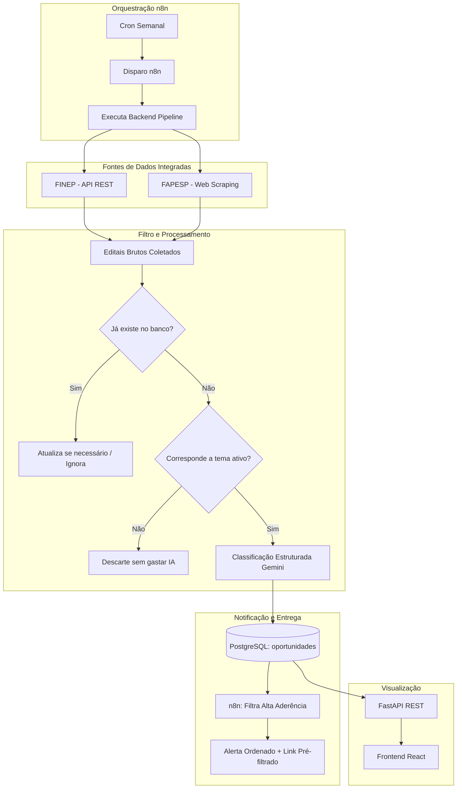

# Fluxo de Dados e Processamento (MVP)

Este documento detalha o caminho percorrido pelos dados: da coleta nas fontes ao processamento por IA, agendamento via n8n e consumo no frontend.

---

## 1. Coleta Multi-fonte

A pipeline coleta chamadas públicas a partir de múltiplos órgãos com módulos independentes:

1. **FINEP:** Consulta o endpoint REST público da instituição, obtendo chamadas abertas e vigentes em formato JSON.
2. **FAPESP:** Realiza scraping HTML na listagem oficial de chamadas com paginação e extração de metadados.
3. As fontes retornam objetos unificados (`RawOpportunity`) contendo título, descrição bruta, prazo preliminar e link da chamada.

---

## 2. Orquestração e Agendamento (n8n)

1. **Disparo Semanal:** Um workflow no **n8n** é disparado semanalmente por um agendador (cron trigger).
2. O n8n aciona o backend para executar a rodada completa de busca em todas as fontes cadastradas.
3. Ao término do processamento:
   - O n8n recebe ou consulta as novas oportunidades processadas;
   - Aplica filtro nas oportunidades classificadas com aderência **Alta**;
   - Gera um comunicado enumerado com título, instituição, prazo e resumo executivo;
   - Inclui o **link pré-filtrado da interface web** (ex: `/?aderencia=Alta`), permitindo que a equipe acesse os editais prioritários com um único clique.

---

## 3. Pré-filtro Temático

Antes de qualquer chamada para a IA:
- O sistema consulta a tabela `temas` no PostgreSQL;
- Realiza uma varredura de palavras-chave no título e descrição de cada edital coletado;
- **Editais sem aderência aos temas cadastrados são descartados imediatamente**, economizando custo de tokens e tempo de resposta.

---

## 4. Análise Semântica com IA (Google Gemini)

Para os editais aprovados no filtro temático:
- Os metadados e o texto bruto são enviados ao Gemini com um prompt estruturado;
- A IA avalia a sinergia com os temas estratégicos (ex: mobilidade sobre trilhos, inovação, transição energética);
- Retorna um JSON estrito validado com: categoria, resumo executivo de alto nível, temáticas identificadas, prazo consolidado e nível de aderência (**Alto**, **Médio**, **Baixo**).

---

## 5. Persistência e Deduplicação

1. O banco PostgreSQL armazena as oportunidades com chave única sobre o `link`;
2. Se uma oportunidade já existir no banco, seus dados podem ser atualizados se houver alteração de prazo ou descrição;
3. O texto bruto original (`descricaoRawText`) é armazenado permanentemente para histórico e conferência interna.

---

## 6. Diagrama do Pipeline de Dados

---

## 7. Preparação para Nuvem Corporativa Azure

O fluxo atual é 100% aderente aos padrões exigidos pela transição corporativa para a **Azure**:
- Chamadas entre frontend e backend via HTTPS com autenticação futura via Entra ID;
- Banco relacional PostgreSQL pronto para ser apontado para Azure Database for PostgreSQL;
- n8n acionando endpoints autenticados da API corporativa.
