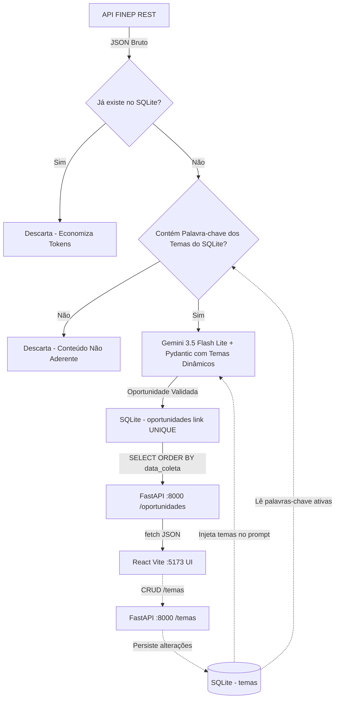

# Fluxo de Dados e Processamento

Este documento descreve o ciclo de vida da informação, desde a origem (APIs de fomento) até a tela do usuário no painel de inovação.

## 1. Ingestão (API REST Pública)
1. O script `scraper_ai.py` é iniciado (via terminal ou rotina agendada).
2. A biblioteca `requests` faz uma requisição HTTP GET para a API de chamadas públicas da FINEP:
   `https://www.finep.gov.br/o/c/chamadapublicas?sort=dataDePublicacao:desc&search=&page=1&pageSize=5`
3. A resposta JSON é desserializada nativamente (`response.json()`), obtendo a lista de itens recentes em formato estruturado.

## 2. Pré-filtro de Deduplicação e Palavras-chave (Otimização de Custos da IA)
1. **Deduplicação de Link:** O script extrai ou infere o identificador/link da chamada (`extrair_link_item`) e consulta o SQLite (`oportunidade_ja_existe`). Se já cadastrado, pula imediatamente.
2. **Pré-filtro Lexical de Temas / Palavras-chave:**
   * O script consulta os temas ativos na tabela `temas` (`obter_temas_db()`).
   * Executa uma varredura lexical em todos os campos textuais do edital bruto retornado pela API.
   * **Se não houver correspondência com nenhuma palavra-chave ativa:** o conteúdo é descartado com log explicativo, sem acionar a API do Gemini (economia de 100% dos tokens).
   * **Se houver correspondência:** a palavra-chave detectada é registrada e o item avança para a análise semântica.

## 3. Processamento Semântico e Validação com IA
1. O coletor gera a URL pública segura usando a biblioteca nativa `urllib.parse`:
   `titulo_codificado = urllib.parse.quote(titulo)`
   `url_publica = f"https://www.google.com/search?q=site:finep.gov.br+{titulo_codificado}"`
2. O payload JSON enriquecido (título, descrição limpa `descricaoRawText`, taxonomia e datas), juntamente com os temas ativos, é enviado para o modelo **`gemini-3.5-flash-lite`**.
3. A IA processa:
   * Classificação de aderência (`Alto`, `Médio`, `Baixo`).
   * Normalização da categoria (`Edital`, `Evento`, `Curso`, `Parceria`).
   * Resumo de até 3 linhas e identificação do prazo.
4. O retorno do modelo é associado ao `url_publica` e ao `descricaoRawText` original na íntegra.

## 4. Persistência e Retenção no Banco (SQLite)
1. O objeto `Oportunidade` é persistido na tabela `oportunidades`.
2. O campo `descricaoRawText` armazena o texto completo da chamada, permitindo consultas internas sem depender de páginas externas que podem retornar 404.
3. O campo `link` armazena o link de busca proxy do Google.

## 5. Distribuição (API REST FastAPI)
1. O servidor ASGI `uvicorn` executa a aplicação `main.py` escutando na porta `8000` via protocolo HTTP (`http://127.0.0.1:8000`).
2. Quando a rota `GET /oportunidades` é requisitada:
   * Uma conexão SQLite é aberta com `sqlite3.Row` para serialização em dicionário.
   * Os dados são recuperados em ordem cronológica decrescente: `SELECT * FROM oportunidades ORDER BY data_coleta DESC`.
   * A API devolve um array JSON formatado com os registros disponíveis.
3. Endpoints de gerenciamento de temas (`GET`, `POST`, `PUT`, `DELETE /temas`) permitem a sincronização dinâmica do CRUD.
4. A documentação interativa Swagger está disponível em `http://127.0.0.1:8000/docs`.

## 6. Consumo e Visualização (Frontend React)
1. O usuário acessa o painel web no navegador em `http://localhost:5173`.
2. O hook `useEffect` em `App.jsx` realiza as requisições `fetch` para `/oportunidades` e `/temas`.
3. O painel renderiza os cards visuais das oportunidades e exibe o botão **"Temas"** com a contagem em tempo real.
4. O usuário conta com:
   * Modal flexível para CRUD completo de temas e palavras-chave.
   * Filtro por temática estratégica (MaaS, Mobilidade sobre trilhos, etc.).
   * Filtro por prazos.
   * Busca textual livre por título ou instituição.
   * Indicadores visuais de aderência baseados na identidade visual de sinalização do Metrô.

## Diagrama Lógico do Pipeline

