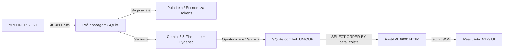

# Fluxo de Dados e Processamento

Este documento descreve o ciclo de vida da informação, desde a origem (APIs de fomento) até a tela do usuário no painel de inovação.

## 1. Ingestão (API REST Pública)
1. O script `scraper_ai.py` é iniciado (via terminal ou rotina agendada).
2. A biblioteca `requests` faz uma requisição HTTP GET para a API de chamadas públicas da FINEP:
   `https://www.finep.gov.br/o/c/chamadapublicas?sort=dataDePublicacao:desc&search=&page=1&pageSize=5`
3. A resposta JSON é desserializada nativamente (`response.json()`), obtendo a lista de itens recentes em formato estruturado.

## 2. Pré-filtro de Deduplicação (Otimização de Custos da IA)
1. Para cada item da lista, o script extrai ou infere o identificador/link da chamada (`extrair_link_item`).
2. É realizada uma consulta prévia no banco local SQLite (`oportunidade_ja_existe`):
   * Se o link já estiver cadastrado: a chamada ao Gemini é **pulada imediatamente**, economizando 100% dos tokens da requisição.
   * Se o link for novo: o item segue para processamento semântico.

## 3. Processamento Semântico e Validação com IA
1. O payload JSON bruto do item, juntamente com o link base sugerido e as diretrizes estratégicas de inovação do Metrô, é enviado para a API do Google Gemini.
2. O modelo **`gemini-3.5-flash-lite`** processa as regras de negócio:
   * Classifica a aderência (`Alto`, `Médio`, `Baixo`).
   * Normaliza a categoria (`Edital`, `Evento`, `Curso`, `Parceria`).
   * Gera um resumo de no máximo 3 linhas.
   * Identifica temáticas e prazos limite.
3. A resposta é validada e tipada rigorosamente através do schema **Pydantic** (`Oportunidade.model_validate_json`), prevenindo inconsistências de tipo ou estrutura.

## 4. Persistência e Deduplicação no Banco (SQLite)
1. O objeto `Oportunidade` validado é submetido à função `salvar_no_banco()`.
2. Os dados são persistidos via `INSERT OR IGNORE INTO oportunidades`:
   * A restrição `link TEXT UNIQUE` garante que nenhuma duplicata seja gravada, mesmo em casos de concorrência ou variações de link.
   * O campo `data_coleta` recebe automaticamente a data e hora do momento da inserção (`CURRENT_TIMESTAMP`).

## 5. Distribuição (API REST FastAPI)
1. O servidor ASGI `uvicorn` executa a aplicação `main.py` escutando na porta `8000` via protocolo HTTP (`http://127.0.0.1:8000`).
2. Quando a rota `GET /oportunidades` é requisitada:
   * Uma conexão SQLite é aberta com `sqlite3.Row` para serialização em dicionário.
   * Os dados são recuperados em ordem cronológica decrescente: `SELECT * FROM oportunidades ORDER BY data_coleta DESC`.
   * A API devolve um array JSON formatado com os registros disponíveis.
   * A documentação interativa Swagger está disponível em `http://127.0.0.1:8000/docs`.

## 6. Consumo e Visualização (Frontend React)
1. O usuário acessa o painel web no navegador em `http://localhost:5173`.
2. O hook `useEffect` em `App.jsx` realiza uma requisição `fetch('http://localhost:8000/oportunidades')`.
3. O estado `oportunidades` é preenchido e a interface renderiza os cards visuais.
4. O usuário conta com filtros reativos em tempo real no cliente:
   * Filtro por temática estratégica (MaaS, Mobilidade sobre trilhos, etc.).
   * Filtro por prazos.
   * Busca textual livre por título ou instituição.
   * Indicadores visuais de aderência baseados na identidade visual de sinalização do Metrô.

## Diagrama Lógico do Pipeline

